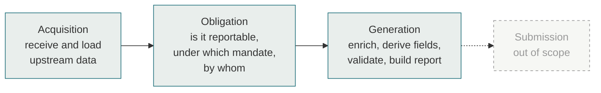
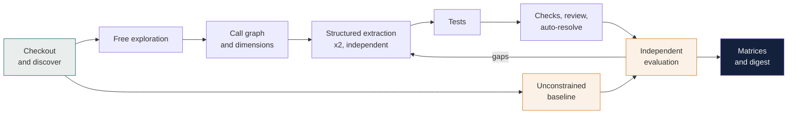
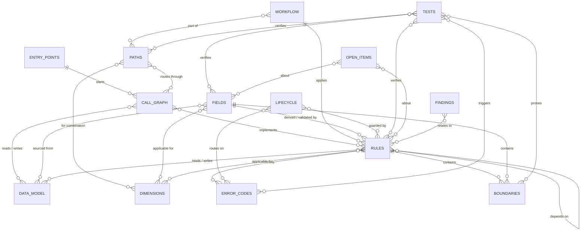
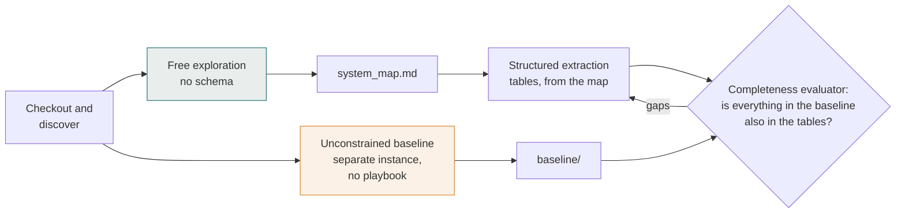
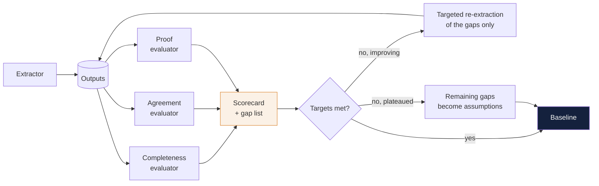
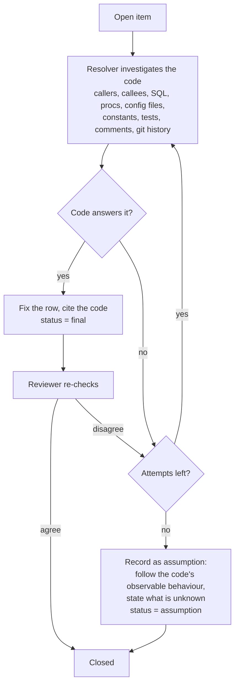
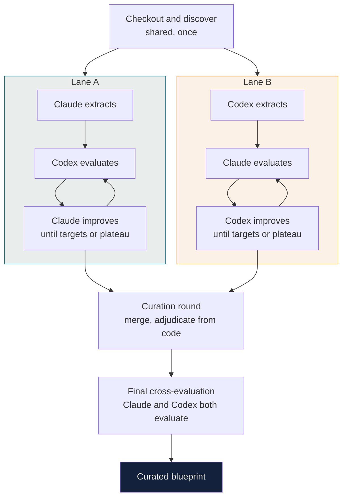

# R2D2 Knowledge Extraction — Playbook

> **Scope:** knowledge extraction only (Week 1 of R2D2 MiFID2 AI Build, Java + DB2).
> **Audience:** the delivery team, and Claude as a reference when running the skills.
> **Companion:** `README.md` — how to run it.

---

## 1. Principles

| Principle | What it means |
|---|---|
| **The legacy code is the source of truth** | What the code does is the answer. Documentation, opinions and the regulation text do not override it. The goal is parity with legacy. |
| **Evidence on every row** | Every row cites the file and lines it came from. No citation, no row. |
| **Machines verify, humans are informed** | Checks, independent AI review and automatic gap resolution replace approval gates. Nothing waits for a human. |
| **Gaps are closed from the code** | Every open item is sent back to the code to be resolved. Only what genuinely isn't in the code becomes a documented assumption — and work continues. |
| **Structured, not prose** | Linked CSV tables, one row per field, rule, transition, column or test. |
| **A floor, not a ceiling** | The tables and columns here are the minimum required output. Claude decides how to investigate, and is expected to go beyond them: adding columns, dimensions, tables or findings whenever the code warrants it. Anything important that doesn't fit the schema goes in `findings.csv` rather than being dropped. |

Two safeguards make sure the playbook does not hold Claude back:
- **Explore first, structure second.** Claude first explores the code freely with no schema and writes its own map of the system. The tables are filled afterwards, from that understanding.
- **Unconstrained baseline.** A separate Claude instance extracts the knowledge with no playbook at all. Anything it finds that the structured run missed is a gap. This turns "is the playbook restricting Claude?" into a measured number on every run.

> **For Claude:** this playbook fixes *what must be delivered and how it is evidenced*. It does not limit *what you look for or how you look*. Use your own judgement to explore the code fully. Procedural steps below are suggested starting points, not the only path. If you find something the schema didn't anticipate, record it.

The only input is the **GitHub locations** of the legacy code — as many repos as make up the system. Everything else is discovered from them.

---

## 2. What is being extracted: the end-to-end flow



The extraction covers **acquisition, obligation and generation** completely, up to the point where a report is ready for submission. Submission is out of scope for now; the handover point into it is captured so it can be added later.

The full workflow is captured across **every combination that changes behaviour**:

| Slice by | Meaning |
|---|---|
| Regulatory mandate | Each regime or report type the code handles |
| Upstream source system | Each feed, and how its data differs on the way in |
| Asset class | Each asset class and its specific logic |
| Event type | New, amend, cancel and any others in the code |
| Lifecycle | Every state and transition from receipt to ready-for-submission |
| Exception scenarios | Failures, parking, reflows, overrides, no-submission, recovery |
| Any other dimension found | From `dimensions.csv` |

Every row in every table carries a `stage` column (`acquisition` · `obligation` · `generation`) and applicability columns for each dimension, so any slice is a filter.

---

## 3. The process



One command runs everything: `/ke-run <github-url> [<github-url> …]`. All repos are treated as one system: a DDL in one repo, stored procedures in another and Java in a third are linked together, and lineage is traced across repo boundaries. Claude splits the work into manageable chunks internally (for example by event type or module) so each pass stays focused.

---

## 4. Outputs

All in `ke/outputs/`. Before each run overwrites them, the previous version is saved to `ke/runs/<timestamp>/`, so any run can be compared or undone. Committing to git is optional and can happen at the end.

| File | One row per | Contents |
|---|---|---|
| `data_model.csv` | Table column | Type, keys, read by, written by, used by fields — from DDL, DAO/entity code, SQL and procs |
| `architecture.calm.json` | Component / flow | Current-state architecture in CALM |
| `call_graph.csv` | Call edge | Every caller → callee across all repos: Java methods, stored procedures, SQL statements, jobs, message handlers, with the call type and evidence |
| `entry_points.csv` | Entry point | Every way processing starts: scheduled jobs, message listeners, file pollers, batch triggers, APIs, DB triggers |
| `workflow.csv` | Processing step | The end-to-end path through acquisition, obligation and generation: step, stage, order, component, input, output, rules applied, next step, exception route, applicability per dimension |
| `paths.csv` | Distinct end-to-end path | Each unique route through the workflow for a combination of mandate × upstream × asset class × event type (and other dimensions), with the ordered step IDs, outcome and tests |
| `coverage.csv` | Code unit | Every in-scope method, stored proc, SQL statement and branch, and the row(s) that account for it |
| `error_codes.csv` | Error / reject / exception code | Every code the code can raise: meaning, triggering condition, stage, related fields and rules, what happens next, message text |
| `boundaries.csv` | Boundary condition | Every threshold, cut-off, limit, null/empty case and precision rule in a condition, with the values either side and the behaviour on each |
| `dimensions.csv` | Dimension value | Every variable the code branches on that changes behaviour, its allowed values, and what it affects |
| `fields.csv` | Reportable field (or logic variant) | Applicability, derivation, format, legacy source, rule and validation IDs |
| `rules.csv` | Rule | Derivations, eligibility, validations, ref data lookups, bundling, overrides (by `rule_type`) |
| `lifecycle.csv` | Transition | From state, trigger, guard rules, to state, action, exception — covers sequencing, exceptions, reflows, overrides, parking, no-submission |
| `tests.csv` | Test case | Given / when / then, the IDs it verifies, existing or derived |
| `open_items.csv` | Gap | What was unclear, how it was resolved, final status |
| `findings.csv` | Anything else worth knowing | Important knowledge outside the schema: hidden coupling, undocumented behaviour, risky or fragile code, control or performance weaknesses, contradictions between repos, implicit business rules, modernisation hazards |

`findings.csv` columns: `id`, `category` (Claude's own), `finding`, `why_it_matters`, `related_ids`, + standard columns. Evidence rules apply as for every other table.

Claude may add further columns or tables when the code calls for them, noting the addition in the digest.

### Columns on every row

| Column | Values |
|---|---|
| `id` | `F-012`, `R-042`, `T-007`… stable across reruns |
| `stage` | `acquisition` · `obligation` · `generation` |
| `evidence` | `repo:path/File.java:120-148` (one or more; always prefixed with the repo name) |
| `evidence_type` | `code` · `assumption` |
| `confidence` | `H` · `M` · `L` |
| `review_verdict` | `agree` · `disagree` (from the independent reviewer) |
| `status` | `final` · `assumption` |

### Field matrix columns (`fields.csv`)

`id`, `variant_id`, `reg_field_no`, `field_name`, `report_label`, `population` (M/C/O), `population_rule_id`, one applicability column per discovered dimension (e.g. `regulatory_mandates`, `event_types`, `upstreams`, `asset_classes`, `appcodes`, `regions`, plus any others found), `derivation_english`, `derivation_pseudocode`, `rule_ids`, `reg_format`, `legacy_source` (table.column / class / proc), + standard columns.

Applicability columns and values come from `dimensions.csv` (section 5.2). The set of columns is not fixed: a newly discovered dimension adds a column. Logic lives once in `rules.csv` and is referenced by ID.

### Generated full-lineage matrices

The linked tables above are the source of truth: each piece of logic, lookup and validation is defined once, with its evidence, and that is what gets extracted, evaluated and improved.

From them, `ke-views` generates two **wide, self-contained matrices** on every run. Each row carries its full lineage written out in full, with no IDs to look up elsewhere. They are the main deliverable for reading, filtering, presenting and building from. They are never edited; they are rebuilt every run, so they cannot drift from the source tables.

**Row granularity:** one row per field (or rule) per **variant**. A new variant row exists only where the code behaves differently, for example a field acquired differently from two upstreams, or transformed differently for an asset class. Where behaviour is identical, one row lists every value it applies to.

#### `fields_matrix.csv` — one row per reportable field variant

| Column | Contents |
|---|---|
| `field_id` / `variant_id` | Stable IDs |
| `reportable_field_name` | Regulatory field name |
| `field_number` | RTS 22 field number (or the mandate's own numbering) |
| `report_label` | How it appears on the report (tag / element / column name in the generated output) |
| `regulatory_mandates` | Mandates the field applies to |
| `population` | Mandatory / conditional / optional, and the condition in plain English |
| `upstreams` | Upstream source systems this variant applies to |
| `asset_classes` | Asset classes this variant applies to |
| `event_types` | Event types this variant applies to |
| `other_dimensions` | Any other discovered dimension that affects this variant (e.g. `venue=XOFF; entity=UK`) |
| `acquisition` | How the data is acquired: upstream feed, message / file / table, source field, load step |
| `source_columns` | Legacy tables and columns read |
| `mapping_transformation_logic` | The transformation, written out in full as pseudo-code |
| `reference_data_lookups` | Each lookup written out: what is looked up, source table, key, value returned, what happens if not found |
| `logic_explanation` | Plain-English explanation of the whole derivation |
| `obligation_dependency` | Obligation rules that decide whether this field is populated or the report produced |
| `regulatory_format` | Format notation (e.g. `{ALPHANUM-35}`, `{DECIMAL-18/13}`) and output formatting applied |
| `validation_rules` | Each validation written out: condition, severity, what happens on failure |
| `boundaries` | Every boundary in the field's logic: condition, behaviour below / at / above, null handling, rounding and precision |
| `error_codes` | Every error or reject code this field can cause, with meaning and next action |
| `overrides` | Any override that can change this field's value: who or what triggers it, and the resulting value |
| `exception_handling` | What happens when acquisition, lookup, transformation or validation fails (park, reflow, default, reject) |
| `lifecycle_impact` | States and transitions this field affects |
| `tests` | Test IDs and one-line scenarios |
| `evidence` | Every `repo:path:lines` the row is built from |
| `confidence` / `status` | Carried from the source rows (`final` or `assumption`) |
| `assumptions` | Any assumption the row depends on, in plain English |
| `source_row_ids` | IDs of the source rows used, for traceability |

#### `rules_matrix.csv` — one row per rule variant

| Column | Contents |
|---|---|
| `rule_id` / `variant_id` | Stable IDs |
| `rule_name` | Short descriptive name |
| `rule_type` | Obligation · eligibility · derivation · enrichment · validation · bundling · override · routing · exception |
| `stage` | Acquisition · obligation · generation |
| `regulatory_mandates` | Mandates it applies to |
| `upstreams` / `asset_classes` / `event_types` / `other_dimensions` | Applicability |
| `trigger` | When the rule runs (event, step, state) |
| `inputs` | Data the rule reads, with source tables and columns |
| `logic` | The rule written out in full as pseudo-code |
| `logic_explanation` | Plain-English explanation |
| `reference_data_dependencies` | Each lookup written out: source, key, value, not-found behaviour |
| `other_rule_dependencies` | Rules it depends on or that depend on it, by name and ID |
| `outputs` | What it produces or changes (fields, flags, state) |
| `fields_affected` | Field names and numbers affected |
| `lifecycle_impact` | States and transitions it drives |
| `boundaries` | Every boundary in the rule: condition, behaviour below / at / above, null handling, rounding and precision |
| `error_codes` | Every error or reject code the rule can raise, with meaning and next action |
| `on_failure` | Exception behaviour: park, reflow, reject, default, alert |
| `tests` | Test IDs and one-line scenarios |
| `evidence` | Every `repo:path:lines` the row is built from |
| `confidence` / `status` | Carried from source rows |
| `assumptions` | Any assumption the row depends on |
| `source_row_ids` | IDs of the source rows used |

The same pattern can generate further views, such as a paths matrix by mandate × upstream × asset class × event type, without changing the source tables.

`ke-check` confirms every matrix row traces back to source rows, and every source field and rule appears in its matrix.

### How they link — a minimum model that each run extends

The link model is **not static**. Below is the **core model**: the minimum set of tables and relationships every run must produce. Free exploration, extraction and the evaluators may extend it whenever the code shows something the core model can't express.



**How it evolves:**

| Change | Allowed? | Condition |
|---|---|---|
| Add a relationship between existing tables | Yes | Evidence in code that the relationship exists and affects behaviour |
| Add a new table (entity) | Yes | A recurring concept in the code that doesn't fit an existing table, e.g. upstream message versions, batch windows, shared state tables, suppression lists |
| Add columns to a table | Yes | The code shows an attribute that matters for rebuilding |
| Remove or rename a core table, column or relationship | No | Core items stay so the matrices, checks and evaluators keep working. If one doesn't apply to this system, it is left empty with a finding explaining why |

**Where the model lives:** `ke/model.yaml`, written by `ke-discover` from the core model and updated by any later step that extends it. It lists every table, its columns and every relationship, each extension with its evidence and the step that added it. The ER diagram in the digest is generated from it on every run, so the picture always matches what was actually extracted.

**What follows the model automatically:**
- `ke-check` reads `model.yaml` to know which IDs must resolve and which links must exist; it is not hard-coded.
- The evaluators use it to decide what to inventory and compare, so a new table is evaluated for completeness and agreement like any other.
- `ke-views` adds any new relationship to the matrices, e.g. a new column in `fields_matrix.csv` if fields gain a link to upstream message versions.
- `ke-tests` adds tests for any new entity that changes behaviour.

**Who decides a change is valid:** proposed extensions go through the same independent review as rows: the reviewer checks the evidence and that the change is needed (no existing table or column can express it). Accepted extensions are listed in the digest under "model changes this run". Because each run starts from the previous `model.yaml`, valid discoveries carry forward and the model gets richer over time.

---

## 5. Extraction — everything from the code

### 5.0 Free exploration and the unconstrained baseline

Before any table is filled, two things happen independently:



**Free exploration (`ke-explore`).** Claude reads the code with no tables, columns or checklist in front of it. The only instruction is the intent: understand how acquisition, obligation and generation actually work, across every mandate, upstream, asset class, event type, lifecycle state and exception, and anything else that matters for modernisation. It writes `ke/explore/system_map.md`: its own account of the system, in whatever structure it judges best, with code citations. Then structured extraction starts from that map, so the tables record what Claude understood rather than steering what it looks for. Anything in the map that doesn't fit a table goes to `findings.csv`.

**Unconstrained baseline (`ke-baseline`).** A separate Claude instance, in a fresh context, is given only the repos and this intent:

> Extract everything there is to know about how this system acquires data, determines reporting obligations and generates reports, to the level of detail needed to rebuild it exactly. Use maximum effort. Cite the code for every statement.

It never sees this playbook, the schema, the system map or the structured outputs. Its output goes to `ke/baseline/`, in whatever form it chooses.

**Comparison.** The completeness evaluator breaks the baseline into individual facts (each rule, field, path, exception, dimension value, finding) and checks each one is present in the structured outputs. Facts in the baseline but missing from the tables are gaps, routed back for targeted extraction like any other gap. The reverse is also recorded: facts in the tables but not in the baseline show what the structure added.

**What the numbers mean:**
- **Baseline recall**: % of baseline facts present in the structured outputs. Target 100%. Anything lower means the playbook constrained Claude somewhere, and the gap log shows where.
- **Structure gain**: facts the structured run found that the baseline did not. This shows what the playbook adds.

Baseline facts that turn out to be wrong (the agreement evaluator re-derives them from the cited code) are discarded, not added.

**Where each kind of knowledge comes from in the code:**

| What | Read from |
|---|---|
| Data model | DDL scripts → entity / DAO / mapping classes → SQL in Java and stored procedures |
| Lineage | SQL reads and writes, stored proc logic, DAO code |
| Fields | Report writer / output mapping code, traced back to source columns |
| Rules | Business logic in Java and procs: conditions, lookups, validations |
| Lifecycle | Status enums and columns, state-changing code, retry / exception handlers, schedulers |
| Tests | Existing test code, plus cases derived from the code's branches |

### 5.1 Call graph

Built immediately after free exploration, before everything else, because the rest depends on it:
- **paths** are routes through the call graph from an entry point;
- **coverage** is measured against its nodes;
- **lineage** follows its data-access edges;
- **dead code** is any node unreachable from an entry point.

**Nodes:** Java methods, stored procedures and functions, SQL statements, tables, scheduled jobs, message queues and topics, files, external calls.

**Edges in `call_graph.csv`:**

| Column | Contents |
|---|---|
| `caller` / `callee` | `repo:class.method`, `repo:PROC_NAME`, `table`, `queue`, `job` |
| `call_type` | `invoke` · `proc_call` · `sql_read` · `sql_write` · `publish` · `consume` · `schedule` · `trigger` · `file_read` · `file_write` · `external` |
| `condition` | The branch condition under which the call happens, if any (rule ID where one exists) |
| `cross_repo` | Y/N |
| `resolution` | `static` (directly in code) · `resolved` (worked out by Claude, e.g. interface implementation, Spring wiring, reflection, dynamic SQL) · `unresolved` |
| `stage` | Acquisition · obligation · generation |
| + standard columns | |

**How it is built:** static analysis tooling where available gives the direct edges quickly and completely; Claude then resolves what tools miss: dynamic dispatch through interfaces and inheritance, dependency injection and configuration wiring, reflection, callbacks, dynamic SQL, stored procedures called by name in strings, job schedules and message routing in config. Every edge cites the code. `unresolved` edges become open items for the resolver.

**`entry_points.csv`:** every way processing starts, with its trigger, schedule or source, stage and the first node it calls. Every path in `paths.csv` starts from one of these.

**Uses beyond extraction:**
- Unreachable nodes are recorded as dead code (and excluded from coverage with evidence).
- Per entry point, a Mermaid call diagram is generated in `ke/diagrams/` for reading.
- In modernisation, it gives the blast radius of any rule or table: everything upstream and downstream of it.

### 5.2 Discovering dimensions

Dimensions are not taken from a list; they are found in the code. A dimension is any variable whose value changes which fields, rules, formats or lifecycle paths apply.

**A suggested approach** (Claude may use any method that finds them more completely):
1. Scan every branch point: `if` / `switch` in Java, `CASE` / `WHERE` / `IF` in SQL and procs, lookup keys, routing tables, filters, config-driven switches.
2. Find the variable each branch depends on and trace it to its source (column, enum, constant, input message field).
3. Keep it as a dimension if it changes reporting behaviour. Drop technical branches (null checks, logging, retries) unless they change the output.
4. Collect its values from enums, constants, `CASE` arms and literals in the code.
5. Record which fields, rules and transitions each value affects.

**`dimensions.csv` columns:** `id`, `dimension`, `value`, `label`, `source` (table.column / enum / input field), `affects_ids` (fields, rules, transitions), `is_default_branch`, + standard columns.

**Coverage gaps it exposes** (each becomes an open item for the resolver):
- **Unhandled combinations:** values that fall through to a default or `else` branch, or are never matched.
- **Dead values:** values defined in an enum or constant but never used in any branch.
- **Hidden values:** values compared in code but not defined in any enum (magic strings and numbers).
- **Runtime-only values:** dimensions driven by reference or config table data, where the code shows the lookup but not the values. These become assumptions.

New dimensions found here are added as applicability columns to `fields.csv` and `rules.csv`, and `ke-tests` adds at least one test per dimension value that changes behaviour.

### 5.3 Tests

Tests come from two sources: **existing tests** in the repos, each linked to what it exercises, and **derived tests** written from the code's own branches.

- Every rule, transition, path, dimension value, error code and exception route gets at least one test; every boundary gets one each side plus the null case; branches of regulatory-critical rules get one each.
- Tests are written as given / when / then so they can become executable tests against the new build.
- Expected results follow **what the code does**. If the code appears to contradict the regulation, the test still records the code's behaviour (that is parity) and the difference is recorded as a finding for Week 2, without blocking extraction.
- Rules with no existing legacy test are recorded as findings, since that behaviour has never been verified.

### 5.4 Error codes and boundaries

**`error_codes.csv`**, one row per code the system can raise (error, warning, reject, exception, status reason):

| Column | Contents |
|---|---|
| `code` | The code as it appears in the system |
| `message` | Message text, if any |
| `meaning` | Plain-English meaning |
| `trigger_condition` | Exactly what causes it, as pseudo-code |
| `stage` | Acquisition · obligation · generation |
| `raised_by` | Rule, workflow step or component |
| `related_fields` / `related_rules` | IDs and names |
| `applicability` | Mandates, upstreams, asset classes, event types, other dimensions |
| `severity` | As the code treats it |
| `next_action` | Park, reflow, reject, default, override, alert, retry, stop |
| `recovery` | How the item leaves this state |
| `tests` | Test IDs |
| + standard columns | |

Found by tracing every place an error, exception, status reason or reject code is set, thrown, logged or written, including codes held in constants, enums, message tables and stored procedure return values. Codes defined but never raised, and codes raised but never defined, are recorded as findings.

**`boundaries.csv`**, one row per boundary in a condition:

| Column | Contents |
|---|---|
| `id` | Stable ID |
| `related_rule` / `related_field` | Where the boundary lives |
| `boundary_type` | Threshold · date/time cut-off · length limit · range · null/empty · precision/rounding · count · timezone |
| `condition` | The comparison as written in code, e.g. `qty >= 1000` |
| `below` / `at` / `above` | The value just below, at and just above the boundary, and the behaviour for each |
| `null_behaviour` | What happens when the input is null, empty or missing |
| `notes` | e.g. inclusive vs exclusive, rounding mode, timezone used |
| `tests` | Test IDs (at least one per side of the boundary) |
| + standard columns | |

Every comparison, range check, length check, date or time cut-off, rounding or precision operation and null check in a business condition gets a row. `ke-tests` generates a test for each side of every boundary, plus the null case.

### 5.5 Workflow and paths

`workflow.csv` describes each processing step once. `paths.csv` then enumerates every distinct route through those steps, so the question "what happens to an amendment of an equity trade from upstream X under mandate Y, including when enrichment fails" is answered by one row with its ordered steps, the rules and fields applied, the exception branches and the tests.

Paths are derived from the code's actual control flow, not from combining dimension values blindly: combinations the code treats identically share one path, and combinations the code never reaches are recorded as unreachable with evidence.

---

## 6. Completeness and accuracy

The target is **everything, 100% accurate**. No single AI pass can promise that on its own, so the method makes completeness and accuracy **provable** rather than assumed.

### 6.1 Completeness: every line of in-scope code is accounted for

`coverage.csv` lists every in-scope code unit (method, stored procedure, SQL statement, branch) across all repos. Each must be either:
- mapped to at least one row (field, rule, workflow step, transition, dimension, test or finding), or
- marked as non-business (logging, plumbing, utilities) with a reason and evidence.

**Extraction is not complete until coverage is 100%.** Anything unmapped goes back to the extractor automatically. This is what catches the things nobody thought to ask about.

### 6.2 Accuracy: independent agreement, then proof

1. **Two independent extractions.** The core tables (fields, rules, workflow, lifecycle, paths) are extracted twice by separate Claude instances that don't see each other's work. Rows that differ become open items.
2. **Adversarial review.** A third instance tries to refute each row from the cited code alone.
3. **Resolution from code.** Every difference or disagreement is settled by the resolver from the code, with the decisive lines cited.
4. **Test proof.** Every rule, path, dimension value and exception route has a given / when / then test derived from the code.

Where the legacy test suite can be executed, the derived tests are run against the legacy code to confirm the extraction describes what the code actually does. Otherwise, the Week 3 parity tests (legacy versus new) are the final proof.

### 6.3 What "100%" means here

- **100% coverage**: every in-scope code unit is accounted for. Measured, not assumed.
- **100% agreement**: every row is agreed by independent extraction and review, or resolved from cited code.
- **Zero open items**: everything is `final` or an explicit `assumption`.
- **Assumptions are counted and listed.** They exist only where the answer is genuinely not in the code (runtime reference data, missing repos, external systems). Each one is a known risk with a test that will catch it in parity testing.

### 6.4 Independent evaluation and improvement

Completeness, agreement and proof are each scored by their **own evaluator**, separate from the extractor, and each score drives an automatic improvement loop.



**What makes an evaluator independent:**
- Separate Claude instance, fresh context, its own skill.
- Sees only the outputs and the code, never the extractor's reasoning or prompts.
- Uses a **different method** from the extractor, so they don't share blind spots. If the extractor works top-down (from report fields back to sources), the evaluator works bottom-up (from code and data inward), and vice versa.

#### The three evaluators

| Evaluator | Question it answers | How it measures independently | Score |
|---|---|---|---|
| **Completeness** | Is anything missing? | Builds its **own** inventory from the code, without looking at the outputs first: every method, proc, SQL statement and branch in scope; every field the report writers populate; every value each dimension takes; every reachable path; every error code raised; every boundary comparison. Then compares with the outputs. Also checks every fact in the unconstrained baseline is present (section 5.0). | % of code units, branches, fields, dimension values and reachable paths represented; baseline recall |
| **Agreement** | Is what's there correct? | Re-derives a sample of rows from the cited code alone, plus every row in high-risk areas (obligation logic, regulatory-critical rules, exception routes). Compares field by field with the extracted row. | % of rows independently re-derived identically; disagreements by table and area |
| **Proof** | Would the tests catch an error? | Checks each test actually asserts the behaviour it claims; runs tests against legacy where executable; **mutation testing**: makes small deliberate changes to the extracted rules (flip a condition, change a value) and checks the tests fail. | % of rules, paths and exception routes with a test; % of tests passing on legacy; mutation score (% of mutations caught) |

#### Evaluating the evaluators

An evaluator that misses things gives false confidence, so each one is tested too. Before scoring a run, known defects are **seeded** into a copy of the outputs: a deleted field, a wrong condition, a missing exception route, a weakened test. The evaluator is scored on how many seeded defects it finds.

- An evaluator that misses seeded defects reruns with the missed defect types written into `ke/lessons.md`, until it catches them; only then is its score used.
- Seeded-defect detection rate is shown on the scorecard alongside the main scores.

#### The improvement loop

1. All three evaluators score the outputs and produce a gap list.
2. Each gap is routed to the extractor or resolver as a **targeted** task: only that field, rule, branch or path is re-extracted, not the whole system.
3. The evaluators score again.
4. The loop repeats until every target is met, or until a round brings no improvement (plateau). Gaps remaining at the plateau become assumptions with evidence of what was tried.

**Targets:** completeness 100%; baseline recall 100%; agreement 100% on re-derived rows; proof 100% of rules, paths and exception routes tested, 100% of runnable tests passing on legacy, mutation score at or near 100%.

#### Improving the method across runs

Every gap the evaluators find is logged with its root cause (e.g. "dynamic SQL not traced", "exception handler in a superclass missed"). At the end of each run, Claude writes recurring root causes as lessons to `ke/lessons.md`, which every skill reads at the start of the next run. No one has to edit the skills. The scorecard history shows whether the method itself is improving.

#### Outputs

| File | Contents |
|---|---|
| `ke/eval/scorecard.md` | The three scores, seeded-defect detection rates, targets, round-by-round trend |
| `ke/eval/gaps.csv` | Every gap found: evaluator, area, related IDs, root cause, round found, how closed |
| `ke/eval/history.csv` | Scores per run, to show the method improving over time |

---

## 7. Verification without approvals

### 7.1 Mechanical checks (script)

- Every row has evidence, and every cited file and line range exists.
- Every referenced ID exists.
- Every field the report writers populate has at least one row in `fields.csv`.
- Every rule and transition has at least one test.
- Every dimension value that changes behaviour has at least one test.
- Every applicability value used in fields and rules exists in `dimensions.csv`.
- Every `legacy_source` column exists in `data_model.csv`.
- Every call graph edge is `static` or `resolved`; `unresolved` edges are open items.
- Every node is reachable from an entry point or recorded as dead code.
- Every path in `paths.csv` starts at an entry point and follows call graph edges.
- `coverage.csv` is 100%: every in-scope code unit is mapped or marked non-business.
- Every workflow step belongs to at least one path; every path has at least one test.
- Every exception route in the workflow has a path and a test.
- Every error code raised in the code is in `error_codes.csv` with a test that triggers it.
- Every boundary in `boundaries.csv` has a test on each side, plus a null-case test.

Failures go straight back to the extractor to fix. No human involved.

### 7.2 Independent AI review

A separate Claude instance, in a fresh context, sees only a row, its cited code and the column schema. It tries to refute the row and records `agree` or `disagree` with a reason. It never sees the extractor's reasoning.

Every `disagree` becomes an open item.

### 7.3 Auto-resolution of gaps

Every open item — reviewer disagreements, low-confidence rows, unclear logic — goes through this loop:



- **Adjudication:** when extractor and reviewer disagree, the resolver decides from the code alone. The cited code wins, not either agent's opinion.
- **Attempts:** up to 3 per item, each going wider or deeper than the last. Claude chooses how to search.
- **Assumptions don't block.** They are written down clearly and carried forward. Typical examples are things that genuinely aren't in the code:
  - values held in reference or config **tables** at runtime (the code shows the lookup, not the data);
  - table or column names built in **dynamic SQL** that can't be resolved statically;
  - behaviour of **external upstream** systems.

Parity tests in Week 3 are the final safety net: if an assumption is wrong, the legacy-versus-new comparison exposes it.

### 7.4 Humans: informed, not asked

At the end of each run, `ke-digest` produces a one-page summary for the team:

- what was extracted and how many rows;
- items resolved automatically from code;
- model changes this run (new tables, columns or relationships);
- scorecard headline numbers;
- remaining assumptions, and repos the code depends on that weren't supplied;
- code-versus-regulation differences noticed.

Nothing in the digest needs action. Nobody's sign-off is required to proceed. Accuracy is measured by the independent evaluators (section 6), not by human sampling.

---

## 8. Skills

| Skill | Does |
|---|---|
| `ke-run <github-url> […]` | Entry point. Runs everything below |
| `ke-discover` | Clones every repo into `legacy/<repo>/`; finds DDL, procs, data-access code, tests, report writers in each; maps how the repos depend on each other (shared libraries, shared tables, calls, feeds); builds code lists from constants/enums; writes `project.yaml` |
| `ke-explore` | Free exploration with no schema; writes `ke/explore/system_map.md` |
| `ke-baseline` | Separate instance, no playbook, intent only; writes `ke/baseline/` |
| `ke-callgraph` | Builds `call_graph.csv` and `entry_points.csv` across all repos: static analysis plus Claude resolving dynamic dispatch, wiring, reflection, dynamic SQL |
| `ke-dimensions` | Finds every behaviour-changing dimension from branch points in the code; writes `dimensions.csv` and coverage gaps |
| `ke-extract` | Data model, architecture, workflow, paths, fields, rules, lifecycle — from code, using the discovered dimensions; run twice independently for the core tables |
| `ke-coverage` | Builds `coverage.csv` and sends any unaccounted code back for extraction until coverage is 100% |
| `ke-eval-completeness` | Independent inventory from the code, compared with the outputs |
| `ke-eval-agreement` | Independent re-derivation of rows from cited code |
| `ke-eval-proof` | Test validity, execution on legacy where possible, mutation testing |
| `ke-eval-seed` | Seeds known defects to measure each evaluator's detection rate |
| `ke-improve` | Routes gaps to targeted re-extraction; repeats evaluation until targets met or plateau; logs root causes |
| `ke-tests` | Existing tests + tests derived from code branches, error codes and boundaries |
| `ke-check` | Mechanical checks (script) |
| `ke-review` | Independent AI review (fresh context) |
| `ke-resolve` | Auto-resolution loop for open items |
| `ke-views` | Generates `fields_matrix.csv`, `rules_matrix.csv` and any other wide views from the source tables |
| `ke-run-cross` | Cross-model mode: runs Lane A and Lane B in parallel, then curation and final cross-evaluation (section 11) |
| `ke-curate` | Merges both lanes, adjudicates differences from the code with both models, builds `ke/blueprint/` |
| `ke-digest` | Non-blocking one-page summary |

`ke-run` calls: `ke-discover` → `ke-explore` and `ke-baseline` (in parallel, independent) → `ke-callgraph` → `ke-dimensions` → `ke-extract` (×2, independent) → `ke-coverage` (loop until 100%) → `ke-tests` → `ke-check` (loop until clean) → `ke-review` → `ke-resolve` → `ke-eval-seed` → `ke-eval-completeness` + `ke-eval-agreement` + `ke-eval-proof` → `ke-improve` (loop until targets met or plateau) → `ke-views` → `ke-check` → `ke-digest`. It saves the previous outputs to `ke/runs/<timestamp>/` first; it does not commit.

Every skill reads `ke/lessons.md` before starting. Every `SKILL.md` follows the same structure: purpose, inputs, required outputs with minimum columns, evidence rules, length limits and done criteria. Skills describe **outcomes**, not step-by-step procedures; where a method is given it is labelled as a suggestion. The few hard rules are about integrity only: never invent IDs or citations, never copy rule logic into field rows, never ask a human to unblock.

---

## 9. Project config — generated, not filled in

Nobody writes the config. `ke-discover` produces it from the repo as a record of what it found, and every later step reads it.

```yaml
# ke/project.yaml — written by ke-discover
repos:                                 # one entry per repo passed to /ke-run
  - name: <repo-a>
    url: https://github.com/<org>/<repo-a>
    commit: <sha>                      # so the extraction is reproducible
    role: <e.g. core reporting engine>
    discovered:
      ddl: [<paths found>]
      stored_procs: [<paths found>]
      java_data_access: [<paths found>]
      report_writers: [<paths found>]
      tests: [<paths found>]
  - name: <repo-b>
    url: https://github.com/<org>/<repo-b>
    commit: <sha>
    role: <e.g. database scripts and procs>
    discovered: { … }

dependencies:                          # how the repos connect, with evidence
  - from: <repo-a>
    to: <repo-b>
    via: <shared table / library / API / file feed>
    evidence: <repo:path:lines>

dialect: db2-luw

scope:                                 # default: everything the report writers produce
  regulatory_mandates: [<from code>]
  event_types: [<from code enums>]
  asset_classes: [<from code enums>]
  regions: [<from code enums>]
  upstreams: [<from code>]

resolve:
  max_attempts: 3
limits:
  cell_max_chars: 500
  digest_max_words: 400
```

**Default scope** is everything the legacy code reports. To narrow it, pass it on the command line, e.g. `/ke-run <url-a> <url-b> exclude: commodities`.

**If a repo is referenced but not supplied** (for example, the code calls a library or reads a table owned by a repo you didn't pass), discovery records it as an open item. The resolver checks the supplied repos for the answer; if it isn't there, it becomes an assumption and the digest lists the missing repo so it can be added on the next run.

Optional: `ke/context/*.md` for anything people volunteer (glossary terms, known quirks). Read by every run; never required.

---

## 10. Done criteria (all automatic)

- [ ] `ke-check` passes
- [ ] Coverage is 100% across all in-scope code in all repos
- [ ] Every path through acquisition, obligation and generation is in `paths.csv` with a test
- [ ] Completeness, agreement and proof scores meet their targets in `ke/eval/scorecard.md`, or have plateaued with remaining gaps listed as assumptions
- [ ] Each evaluator's seeded-defect detection rate is recorded
- [ ] Baseline recall is 100%: everything the unconstrained run found is in the structured outputs, or was shown to be wrong from the code
- [ ] Every row has a review verdict of `agree`, or has been through auto-resolution
- [ ] Every open item is `final` or `assumption` — none left open
- [ ] Every rule and transition has a test
- [ ] Outputs saved as the baseline (commit and tag `ke-baseline-v1` whenever you're ready)

---

## 11. Cross-model mode: Claude and Codex

Two model families, two independent lanes, then a curation round that produces one blueprint. Each model's blind spots are checked by the other.

> Model names below are as used by the team: **Claude Opus 5.5 at maximum effort** and **Codex GPT 6 Astra**. Confirm the exact model IDs and effort settings available in your installations before running.



### 11.1 The lanes

| | Lane A | Lane B |
|---|---|---|
| Extracts (explore, call graph, dimensions, tables, tests) | Claude Opus 5.5, max effort | Codex GPT 6 Astra |
| Evaluates (completeness, agreement, proof, seeded defects) | Codex GPT 6 Astra | Claude Opus 5.5, max effort |
| Improves (targeted re-extraction of gaps) | Claude | Codex |
| Output folder | `ke/lane-a/` | `ke/lane-b/` |

**Rules for both lanes:**
- Both start from the same checkout, `project.yaml` and core `model.yaml`. Each may extend its own copy of the model.
- Both produce exactly the same tables, columns and formats (sections 4–5), so they can be compared row by row.
- **The lanes never see each other's work** until curation. An evaluator sees only its lane's outputs and the code, never the extractor's reasoning.
- Each lane runs its own unconstrained baseline with its own model (Lane A: Claude, Lane B: Codex). The final cross-evaluation checks the curated blueprint against **both** baselines, so anything either model finds unprompted must be in the blueprint.
- Each lane runs its full improvement loop to targets or plateau before curation.

### 11.2 The curation round

`ke-curate` merges both lanes into `ke/blueprint/`. Every fact (field variant, rule, path, transition, error code, boundary, dimension value, call edge, model extension, finding) is matched across lanes and classified:

| Case | Action |
|---|---|
| **Both lanes agree** | Accepted. Evidence from both lanes kept. |
| **Only one lane has it** | Adjudicated from the code (below). |
| **Lanes disagree** | Adjudicated from the code (below). |
| **Both lanes mark it an assumption** | Kept as an assumption. |

**Adjudication**, with no human involved:
1. Claude and Codex each independently re-derive the fact from the cited code, without seeing each other's answer.
2. If they agree, that answer is accepted, with the decisive code lines cited.
3. If they still disagree, each is shown the other's answer and cited lines and asked to refute it from the code. The answer that survives, with the stronger code citation, is accepted.
4. If neither can be refuted, or the code genuinely can't settle it, it becomes an assumption with both readings recorded and a test that will distinguish them in parity testing.

Every curated row records its **provenance**: `both` · `lane-a-only` · `lane-b-only` · `adjudicated`, with the adjudication reasoning and evidence. The blueprint is built from the same source tables and core model, so `ke-views` generates `fields_matrix.csv`, `rules_matrix.csv` and the other views from it exactly as in single-model mode.

### 11.3 Final cross-evaluation

The curated blueprint is evaluated by **both** models, each running the full completeness, agreement and proof evaluation. Any gap either finds goes through adjudication again. The loop ends when both evaluators meet the targets, or plateau.

### 11.4 The cross-model scorecard

`ke/blueprint/scorecard.md` adds:
- **Lane agreement:** % of facts found identically by both lanes, by table and by stage.
- **Unique finds:** facts only one lane found that survived adjudication, by lane. This shows what each model contributes.
- **Adjudication outcomes:** how many were settled by re-derivation, by refutation, or left as assumptions.
- **Final scores** from both evaluators on the curated blueprint, including baseline recall against each model's unconstrained baseline.

### 11.5 Running it

```
/ke-run-cross <github-url> [<github-url> …]
```

Runs: shared checkout and discovery → Lane A and Lane B in parallel → `ke-curate` → final cross-evaluation → `ke-views` → digest. Claude Code orchestrates; Codex is called from Claude Code as a command or MCP server, each call with a fixed prompt defined in the skill.

```
ke/
├── lane-a/        # Claude extracted, Codex evaluated
├── lane-b/        # Codex extracted, Claude evaluated
└── blueprint/     # curated result: source tables, matrices, scorecard, digest
```

**To refine further**, run another curation round: `/ke-curate` re-runs adjudication and final cross-evaluation on the current blueprint, without re-running the lanes.

**Governance:** this sends the legacy code to two vendors. Confirm both are approved for this codebase before running.

---

## 12. Known trade-offs

- **Legacy bugs are reproduced.** Using the code as truth means a bug in legacy becomes a row in the spec. That is correct for parity; differences from the regulation are listed in the digest for Week 2 to decide.
- **Assumptions can be wrong.** They're explicit, few, and caught by parity tests in Week 3.
- **Accuracy is measured, not approved.** Confidence comes from the evaluators' scores, seeded-defect detection rates and, in cross-model mode, agreement between two model families.
- **Cost and time.** Independent passes, evaluators and cross-model lanes use far more compute than a single pass. That is the price of measured completeness.
